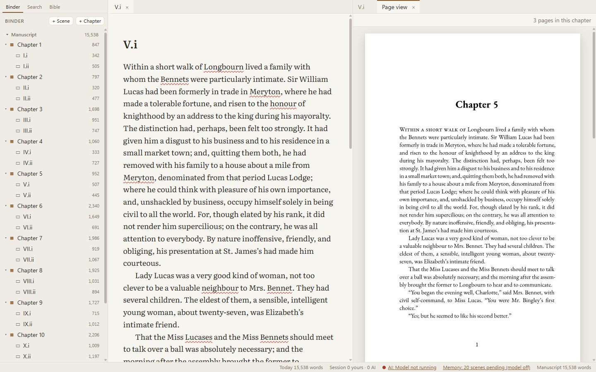
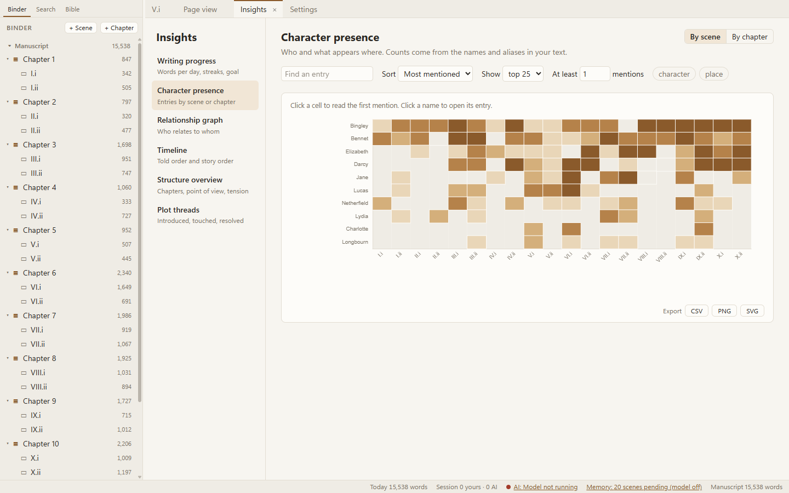

# Margin

**A quiet writing studio for books, with an assistant that lives entirely on your own computer.**

Margin is a Windows desktop app for writing a novel or a non-fiction book. You write in a calm editor; a local language model can offer ghost-text suggestions, remember your story, and answer questions about your manuscript, but it **never changes your words unless you press accept**. Nothing leaves your machine: no accounts, no cloud, no telemetry.


*The scene you are writing (left) and the same chapter as it will print (right). Click a line on the page to jump to that paragraph.*


*Insights shows who appears where, how the story is paced, and what threads are still open. Both pictures show Jane Austen's* Pride and Prejudice *(public domain).*

---

## For writers

### What you get

- **A focused editor.** Chapters, scenes, front and back matter, notes and research in a binder. Focus mode, typewriter scrolling, full-screen, themes (light, sepia, dark, high contrast), smart quotes, footnotes, comments, spell-checking (US or Canadian English), find and replace across the whole book.
- **Your work is safe.** Everything is saved as plain Markdown files in a folder you choose. Autosave, crash recovery that loses at most the last two seconds, automatic history snapshots you can compare and restore, and scheduled backups. Deleting something is always undoable: there are no "Are you sure?" pop-ups.
- **A local AI that stays in its place.** Ghost text finishes your sentence in dim type; `Tab` accepts it, and typing or `Esc` dismisses it. A side panel offers ideas, answers questions about your book with citations, and suggests alternative phrasing. Anything the model works out about your story (characters, places, plot threads, timeline) is kept in a *Story Memory* you can read and correct. Your own notes are canon and the model can never overwrite them.
- **Insights.** Words per day and streaks, who appears in which scene, a relationship graph, told order versus story order, point of view and tension, plot threads.
- **Page view.** See the chapter you are writing typeset as a book page, right next to the text.
- **Export.** Word (standard manuscript format for submissions, or a styled document), a typeset PDF with real book layout, Markdown, or plain text. Four built-in templates use bundled open-licence fonts (EB Garamond, Crimson Text, Source Serif 4), and you can save your own.
- **Writing aids.** Sprint timer, daily and project word goals with a deadline calculator, read-aloud for proofreading, quick capture of a stray thought, a scratchpad that is never exported.

### Install

1. Download `Margin_0.1.0_x64-setup.exe` (or the `.msi`) from the [latest release](https://github.com/tracesfx/margin/releases/latest). `SHA256SUMS.txt` is there too. Margin is not code-signed yet, so Windows SmartScreen may warn the first time: choose **More info → Run anyway**.
2. Run it. The `.exe` installs for your user only and needs no administrator rights.
3. Start Margin, choose **New project**, and pick where its folder should live.

To build an installer yourself, see [For developers](#for-developers).

### First steps

| Do this | Keys |
|---|---|
| Open the command palette (every action, by name) | `Ctrl+K` |
| Jump to any scene or entry | `Ctrl+P` |
| New scene / new chapter | `Ctrl+N` / `Ctrl+Alt+N` |
| Show all shortcuts (they can all be rebound) | `Ctrl+/` |
| Focus mode / typewriter / full screen | `F9` / `Shift+F9` / `F11` |
| Page view beside the text | `Ctrl+Alt+L` |
| Insights | `Ctrl+Alt+V` |
| Export | `Ctrl+Alt+E` |
| Start a 25-minute sprint | `Ctrl+Alt+T` |
| Read the selection (or scene) aloud | `Ctrl+Alt+R` |
| Quick capture to your Inbox | `Ctrl+Shift+N` |
| Save a named snapshot / history | `Ctrl+Alt+S` / `Ctrl+Alt+H` |

A short welcome guide appears the first time you open a project. Bring it back from the palette with **Show the welcome guide**.

### Turning on the AI (optional)

Every feature except the assistant works without a model. To use the assistant:

1. Download a `llama.cpp`-compatible model and its `llama-server`. Margin's default is **Ternary Bonsai 9B**, which needs the PrismML build of `llama-server`; it runs fully on a 12 GB graphics card.
2. Open **Settings → Models**, point Margin at the server program and the model file, and press connect. Margin starts and stops the server itself and only ever talks to `127.0.0.1`.
3. Ghost text, Ideas, Ask and Story Memory switch on. You can turn all AI off with one master switch, or pause ghost text for a "flow mode" (`Ctrl+Alt+F`).

### Your files

A project is an ordinary folder you can back up, sync, or open in any text editor:

```
My Novel/
  project.yaml            title, author, binder order
  manuscript/             one Markdown file per scene or chapter
  front-matter/ back-matter/ notes/ research/ trash/
  bible/                  your story notes (characters, places, ...)
  memory/                 what the assistant has worked out (readable JSON)
  exports/ templates/     your export profiles and saved templates
  .margin/                caches and history; safe to delete, rebuilt on demand
```

### Privacy

- No telemetry, no analytics, no accounts, no fonts or scripts loaded from the internet.
- The app talks only to the model server on your own machine.
- **One optional exception, off by default:** *Settings → Updates* can ask GitHub once a day whether a newer Margin exists. It sends nothing but what any web request reveals (your address and the name `Margin-update-check`): no text, no project, not even your version. It never downloads or installs anything; it shows a notice and a link, and you decide. You can also press **Check now** whenever you like.

### Known limits

Windows 10/11 only. English only. Not code-signed, and there is no in-app updater (the optional update check only tells you). Sunken drop caps, Word list numbering and Word comments in exports are not built. The full list of decisions and gaps is in [`docs/progress.md`](docs/progress.md).

---

## For developers

Margin is a [Tauri 2](https://tauri.app) app: a Rust backend and a React + TypeScript (strict) frontend around a TipTap / ProseMirror editor. [`SPEC.md`](SPEC.md) is the source of truth for behaviour; [`CLAUDE.md`](CLAUDE.md) holds the working rules for contributors (human or AI).

### Prerequisites

- Windows 10/11, Rust (stable, MSVC toolchain) with Visual Studio Build Tools and the Windows SDK, a recent Node.js (24 was used).
- WebView2 (preinstalled on Windows 11).
- For the AI features only: `llama-server` and a GGUF model (see above). Tests never need a GPU.

### Run, test, build

```bash
npm install
npm run tauri dev            # the app, with hot reload; also regenerates src/sdk/bindings.ts

npm test                     # frontend tests (Vitest)
npm run typecheck && npm run lint
cargo test --manifest-path src-tauri/Cargo.toml --lib
cargo clippy --manifest-path src-tauri/Cargo.toml --all-targets -- -D warnings
cargo fmt --manifest-path src-tauri/Cargo.toml

npm run tauri build          # NSIS + MSI installers in src-tauri/target/release/bundle/
```

Real-model tests are opt-in (`MARGIN_LIVE_MODEL=1`, a server on `:8080`); see `CLAUDE.md` for the exact commands, for driving the running app over CDP/Playwright, and for known build gotchas (such as clearing `%LOCALAPPDATA%\tauri\NSIS` if packaging fails).

### Architecture in one screen

```
src-tauri/src/                    Rust backend
  project/   file format, atomic writes, file watcher
  story/     Story Data Service: typed queries + validated commands (canon rules live here)
  events/    typed domain-event bus
  ai/        scheduler, llama-server client, presets, context builder, context log
  memory/    indexer, extraction, retrieval, embeddings
  history/   git2 snapshots, diff, restore        backup/  scheduled zips
  stats/ spell/ dialect/ (the Markdown dialect, lossless round trip)
  export/    book model, Markdown/Word/Typst exporters, Page view
  update.rs  the opt-in update check (the only non-local request)
src/                              Frontend
  app/       shell: layout, command palette, keymap, settings
  editor/    TipTap extensions: semantic styles, ghost text, provenance
  sdk/       @margin/sdk: the only API modules may use; generated IPC bindings
  modules/   first-party modules, each a folder with a module.ts manifest
docs/        data-format.md, sdk.md, progress.md, hello-view/ (a sample module)
fixtures/    public-domain sample manuscripts for tests
```

Features are **modules** built on the Story Data Service, the event bus and the SDK. A module declares what it contributes (`workspaceViews`, `sidebarPanels`, `marginTabs`, `insightsViews`, `commands`, `statusBarItems`, `settingsPages`, `exporters`, ...) and never reaches into another module. Module folders are discovered automatically, so a new Insights view is one new folder; `docs/hello-view/` shows how, and [`docs/sdk.md`](docs/sdk.md) documents the API. Persisted file formats are in [`docs/data-format.md`](docs/data-format.md). IPC types are generated by `tauri-specta`; never hand-write them.

### Rules the code is built around

These come from SPEC §2 and are enforced by tests and review:

1. The AI **never** modifies manuscript text except through an explicit accept. Ghost text is a ProseMirror decoration only: never in the document, never in undo history, never saved.
2. Typing is never blocked: no AI, I/O or indexing work on the UI thread.
3. **No network** except configured `127.0.0.1` model endpoints and the opt-in update check. No telemetry, no CDN assets; fonts and libraries are bundled.
4. **Canon is sacred.** AI writes may only create or update *inferred* records, enforced in the Rust Story Data Service, not just the UI.
5. No modal confirmations for routine actions; make them undoable or recoverable.
6. Every project file is written atomically (temp, fsync, rename).
7. Everything the model tracks is inspectable and traceable to a source passage.

### Conventions

Rust: `thiserror` for errors, no `unwrap`/`expect` outside tests, long work on background tasks. TypeScript: strict, small Zustand stores per module. IDs are ULIDs. Every persisted file has a `schemaVersion` with a migration and test. Keep dependencies lean and say why in the commit when adding one. Update `SPEC.md` and `docs/` in the same change as any deviation.

### Status

All seven milestones in SPEC §16 are built; [`docs/progress.md`](docs/progress.md) has the checklists, acceptance results and measured performance (150k-word project shows its binder in 0.3 to 0.4 s; keystroke to paint under 16 ms).

### Licences

The bundled book fonts are under the SIL Open Font License 1.1 (see [`src-tauri/fonts/`](src-tauri/fonts/)). The sample manuscripts in `fixtures/` are public domain (Project Gutenberg). This project has not yet chosen a licence for its own code.
